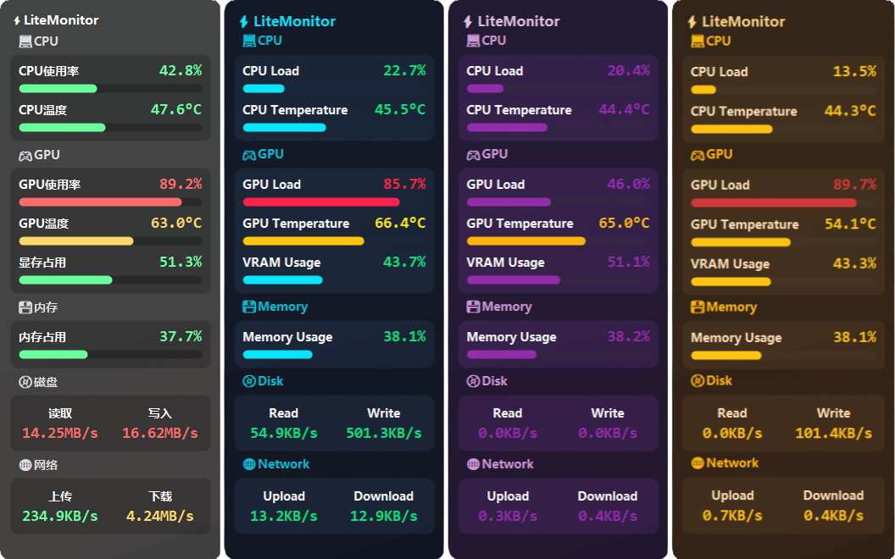
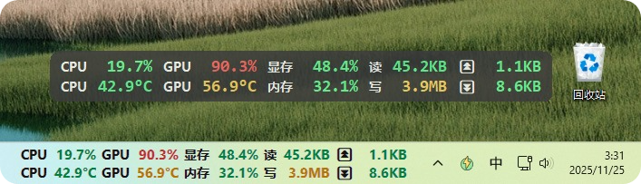
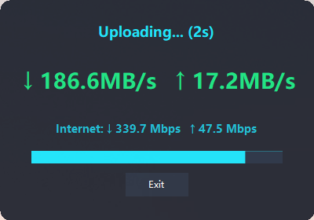
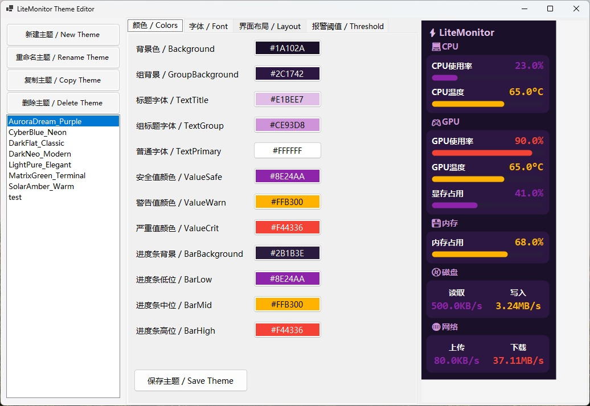

[中文文档](./README.md)

#  LiteMonitor

A lightweight and fully customizable **Windows hardware monitor** — track CPU, GPU, memory, disk, and network statistics in real time.

> 🟢 **Download latest version:**  
> [📦 GitHub Releases → LiteMonitor Latest](https://github.com/Diorser/LiteMonitor/releases/latest)  
> [⏬ Download Website](https://litemonitor.cn/)

LiteMonitor is a modern **Windows desktop system monitoring tool**.  
It supports horizontal/vertical display, multiple languages, theme switching, transparency, adaptive DPI scaling, and three-level color alerts — in a clean and highly configurable interface.



###  🟢 **Horizontal Mode / Taskbar Display**


###  🟢 **New Network Speed Test Feature**
  👉  

###  🟢 **New Theme Editor**


---

# 🖥️ Monitoring Features

| Category | Metrics |
|-----------|----------|
| 💻 **CPU** | Real-time usage & temperature (multi-core average + peak). |
| 🎮 **GPU** | GPU usage, temperature, VRAM usage; supports NVIDIA / AMD / Intel. |
| 💾 **Memory** | RAM usage overview in percentage. |
| 📀 **Disk** | Read/Write throughput (KB/s, MB/s). Auto/manual disk selection supported. |
| 🌐 **Network** | Upload/Download speed with adaptive unit formatting. Auto/manual NIC selection supported. |

---

# Product Features

| Feature | Description |
|--------|-------------|
| 🎨 **Theme Customization** | JSON-defined colors, fonts, spacing, corner radius. New Theme System v2 with cleaner structure & scaling logic. |
| 🟥🟨🟩 **Three-Level Color Alerts** | Bars and values change colors based on thresholds; network/disk have independent logic. |
| 🌍 **Multilingual UI** | Supports 8 languages (ZH/EN/JA/KO/FR/DE/ES/RU). Switching languages updates UI instantly. |
| 📊 **Show/Hide Metrics** | Toggle CPU/GPU/VRAM/MEM/NET/DISK modules individually. |
| 🧮 **Horizontal Mode** | Brand-new two-row layout with per-column dynamic width, smart unit formatting, and automatic panel width calculation. |
| 📏 **Adjustable Panel Width** | Change width from menu; layout refreshes instantly. |
| 🔠 **UI Scaling (UIScale)** | Full DPI + user-defined scaling support; fonts and layout resize proportionally. |
| 🎞️ **Smooth Animations** | Numeric values transition smoothly; speed configurable. |
| 🪟 **Window Features** | Rounded corners, transparency, high-quality text rendering, always-on-top. |
| 🧭 **Auto Hide on Screen Edge** | Automatically collapses when docked to edges; reappears on mouse hover. Multi-monitor aware. |
| 🧲 **Clamp to Screen** | Prevents window from being dragged outside visible screen area. |
| 👆 **Click-Through Mode** | Allows mouse interactions to pass through the window. |
| 🎨 **Instant Theme/Language Switching** | No restart required; UI updates immediately. |
| 🔍 **Smart Value Formatting** | Automatic unit conversion, adaptive decimals; horizontal mode removes `/s`, trims decimals for large values. |
| 🔄 **Auto Update Check** | Silent background check on startup; popup only when triggered manually. |
| 🚀 **Auto Startup** | Uses Windows Task Scheduler (supports elevated run). |
| 📂 **Persistent Settings** | All preferences saved to `settings.json` in real time. |

---

## 📦 Installation

1. Download from [GitHub Releases](https://github.com/Diorser/LiteMonitor/releases)
2. Extract and run `LiteMonitor.exe`
3. The app automatically loads the correct theme & language

---

## 🌐 Multilingual Support

Language files are stored in `/resources/lang/`:

| Language | File |
|-----------|------|
| Chinese (Simplified) | `zh.json` |
| English | `en.json` |
| Japanese | `ja.json` |
| Korean | `ko.json` |
| French | `fr.json` |
| German | `de.json` |
| Spanish | `es.json` |
| Russian | `ru.json` |

---

## 🎨 Theme System

Themes are stored under `/resources/themes/` as JSON files.

Example:
```json
{
  "name": "DarkFlat_Classic",
  "layout": { "rowHeight": 40, "cornerRadius": 10 },
  "color": {
    "background": "#202225",
    "textPrimary": "#EAEAEA",
    "barLow": "#00C853"
  }
}
```

**Theme System v2 Improvements:**
- Unified layout fields  
- Separate scaling for layout (DPI×UIScale) and fonts (UIScale only)  
- Cleaner JSON structure, easier for custom themes  

---

## ⚙️ Settings (settings.json)

| Field | Description |
|--------|-------------|
| `Skin` | Current theme name |
| `PanelWidth` | Panel width (works in both modes) |
| `UIScale` | User interface scaling factor |
| `Opacity` | Window opacity (0.1–1.0) |
| `Language` | Active language |
| `TopMost` | Always-on-top |
| `AutoStart` | Run at system startup |
| `AutoHide` | Enable auto-hide on screen edges |
| `ClampToScreen` | Prevent dragging window outside visible screen |
| `ClickThrough` | Allow mouse pass-through |
| `RefreshMs` | Refresh interval |
| `AnimationSpeed` | Smooth animation speed |
| `HorizontalMode` | Horizontal/Vertical display |
| `PreferredNetwork` | Manual NIC selection (empty = auto) |
| `PreferredDisk` | Manual disk selection (empty = auto) |
| `Enabled` | Toggles for CPU/GPU/MEM/NET/DISK modules |

---

## 🧩 Architecture Overview

| File | Responsibility |
|------|----------------|
| `MainForm_Transparent.cs` | Window behavior, drag, menus, auto-hide, transparency |
| `UIController.cs` | Theme loading, DPI/UIScale scaling, layout rebuilds, rendering |
| `UIRenderer.cs` | Vertical-mode rendering (groups, bars, texts) |
| `HorizontalRenderer.cs` | Horizontal-mode rendering (two-row layout) |
| `UILayout.cs` | Dynamic vertical layout calculation |
| `HorizontalLayout.cs` | Column width and total panel width calculation |
| `ThemeManager.cs` | Load themes, parse colors, build fonts |
| `LanguageManager.cs` | Localization loader with flattened key access |
| `HardwareMonitor.cs` | Collects CPU/GPU/MEM/NET/DISK data; smart device auto-selection |
| `AutoStart.cs` | Manages Windows Task Scheduler startup task |
| `UpdateChecker.cs` | GitHub + China mirror version checking |
| `AboutForm.cs` | About dialog |

---

## 🛠️ Build Instructions

### Requirements
- Windows 10 / 11  
- .NET 10 SDK  
- Visual Studio 2022 / JetBrains Rider

### Build
```bash
git clone https://github.com/Diorser/LiteMonitor.git
cd LiteMonitor
dotnet build -c Release
```

Output:
```
/bin/Release/net10.0-windows/LiteMonitor.exe
```

### Publish (single file, order matters)

Two shapes are available; the default matches upstream — **framework-dependent single file**:

| Shape | Command | exe size | Ship zip | Target machine |
| --- | --- | --- | --- | --- |
| Framework-dependent (default) | `.\build-net10.ps1` | ~5.8 MB | ~2.4 MB | needs .NET 10 Desktop Runtime |
| Self-contained (optional) | `.\build-net10.ps1 -SelfContained` | ~82 MB | — | no runtime needed |

The upstream v1.3.6 package is ~2.8 MB because it uses a framework-dependent single-file exe
plus a framework-dependent updater (~166 KB), packed into a zip. This branch aligns with that
approach by default. Both shapes are still genuinely single-file: default themes / languages /
plugins and the updater are embedded into the exe as `EmbeddedResource`.

```powershell
.\build-net10.ps1                    # default: small build
.\build-net10.ps1 -SelfContained     # optional: runtime-free self-contained build
```

The script:

1. Publishes the single-file updater (framework-dependent by default, ~170 KB) and overwrites
   `resources\LiteMonitor.Updater.exe` (build-time artifact, no longer committed to the repo);
2. Publishes the app with `PublishSingleFile=true`, embedding the `resources` payload;
3. Verifies the publish output contains only one exe, that resources were not copied as external
   content, records SHA256 hashes, and removes intermediate folders;
4. For the framework-dependent shape, also produces a ship zip containing only the exe
   (never `settings.json` or other user data).

Default output: `dist\LiteMonitor-single\LiteMonitor.exe` (6,160,154 B / 5.87 MB) and
`LiteMonitor-net10-win-x64.zip` (2,506,064 B / 2.39 MB).

**Build toolchain**: a portable .NET 10 SDK `10.0.403` ships with the project in `_sdk10\`
(git-ignored, so other projects cannot wipe it). The script uses `_sdk10\dotnet\dotnet.exe` by
default and only falls back to `dotnet` on PATH if absent; override with
`.\build-net10.ps1 -DotNet "F:\path\to\dotnet.exe"`.
If `_sdk10` is removed, re-download the official zip (no system install, no PATH change):
`https://builds.dotnet.microsoft.com/dotnet/Sdk/10.0.403/dotnet-sdk-10.0.403-win-x64.zip`
→ extract into `_sdk10\dotnet\` so that `dotnet.exe` sits at `_sdk10\dotnet\dotnet.exe`.

Build checksums:

- Framework-dependent exe SHA256 `8C8286846E5C4D67A27AC84CA59FE9A2F783CD7C544379594C8E7BDC8B1C045E`
- Ship zip SHA256 `9E9108B2A39978241D6BC500ED16D635B292CB86D25C341168C1C7366CE874D5`
- Embedded updater (framework-dependent) SHA256 `3F378C4C36BFB5E05D9C58B887C5236B074734D8EC5091D8EFBDDD191C019F84`
- Self-contained exe SHA256 `77BB5E7F316DF0F74270EDE34CFDE11A531854666652C8EB399BCE87107AD690` (86,035,119 B / 82.05 MB, republished in the same batch)
- Embedded updater (self-contained) SHA256 `F9E511AFEAE67838621074906BDDB59B60BFB3806EEC7A7A831AD027D7FD8D7C`

> The updater is published fresh on every build and its single-file bundle carries a build id, so
> its hash changes between publishes of identical sources. `resources\LiteMonitor.Updater.exe`
> only keeps the framework-dependent shape (174,193 B) for the next build to overwrite.

> **Trade-off**: the framework-dependent build needs .NET 10 Desktop Runtime on the target
> machine (this SDK ships 10.0.14); the self-contained build bundles the runtime and runs on
> any Win10/11 x64 at the cost of ~82 MB. `EnableCompressionInSingleFile` works only for
> self-contained publishing (framework-dependent raises NETSDK1176), so the script toggles it.
>
> **First run**: the exe recreates a `resources\` folder next to itself (themes / languages /
> plugins / updater) and then reads and writes `settings.json` in the same folder as before.
> Existing files are never overwritten, so custom themes and updated updaters are preserved.
>
> **Interactive-entry guard**: if all three entry points (main window, taskbar window, tray icon)
> become unusable at once — main window hidden or click-through, taskbar display off or
> click-through, tray icon hidden — the app re-enables the tray icon and persists the fix, so the
> overlay can never become unclickable and unrecoverable. Bad `settings.json` values are healed on
> startup too. Regression tests: `test/入口守卫回归/` (20 assertions).
>
> **Single settings window**: the right-click menu, tray, taskbar window, plugin-manager entry and
> double-click actions all go through `SettingsFormHost`. Reopening only switches the page, restores
> and activates the existing window instead of stacking new ones, so multiple Draft configs can no
> longer overwrite each other. Regression tests: `test/设置面板单例回归/` (24 assertions).
>
> **Auto-start state reconciliation**: this toggle uses the Windows scheduled task
> `LiteMonitor_AutoStart` (logon trigger, highest privileges), so it does **not** appear in
> "Settings → Apps → Startup" — that list only enumerates registry Run entries and Startup folder
> shortcuts. Check "Task Scheduler → Task Scheduler Library" instead. The app now reads back the
> real task state (disabled, pointing at a different exe, or deleted externally all show as off),
> rolls the checkbox back with an error message when `schtasks` fails, and recreates a missing task
> whenever "Apply" is clicked in the settings panel.
>
> **Edge auto-hide state machine**: the decision logic lives in `src/Core/AutoHideState.cs`
> (plain C#, unit-testable). It fixes a lost `MouseUp` freezing the drag flag forever, position
> clamping desynchronising from the hidden state, the display-change fallback not resetting state,
> being unable to unhide on multi-monitor setups, and system clock adjustments affecting the
> keep-visible window; bottom-edge hiding is now supported too.
> Regression tests: `test/自动隐藏状态机回归/` (55 assertions).
>
> **Laptop fan RPM (fallback-capable, multi-source adapter layer)**: notebooks with EC-controlled
> fans (e.g. the Xiaomi Mi Gaming Laptop 15.6 / TM1806) expose no `Fan` sensors to
> LibreHardwareMonitor. Fan sources now live in `src/System/HardwareServices/FanSources/`:
> a per-machine rule catalogue (`FanProfileCatalog`), a health-based `FanSourceSelector`, a
> singleton `FanSourceManager`, and an `IFanSource` contract that makes each source registrable,
> replaceable and diagnosable. On the verified machine (rule `xiaomi-tm1806-ec`), **EC direct
> read is the primary source**: it reuses LHM 0.9.6's `WindowsEmbeddedControllerIO` to read two
> little-endian 16-bit tachometers from EC `0x00`–`0x03` every 2 seconds. The vendor
> `root\wmi:RW_TMAWMI` block is now the **cross-check and fallback source**, also used to
> calibrate which tachometer is CPU vs GPU. Only when every source is unavailable does the app
> fall back to generic LHM sensors; a genuine no-reading state shows `--`, not `0 RPM`.
> Minimising the Xiaomi control centre stops its front-end heartbeat and freezes the WMI block;
> freshness detection (identical raw bytes across consecutive frames) drops that source and the
> selector switches to EC, so **RPM stays live** without the vendor tool in the foreground.
> On other machines the WMI poll is permanently disabled once the class is confirmed absent,
> and a block is accepted only if it is 32 bytes with the expected zero regions and plausible
> RPM values, so a same-shaped block on another brand cannot produce a bogus number.
> "Right-click → System hardware details" reports the machine, active source and each
> adapter's state. Also fixed: `GPU.Fan` no longer treats `Control` (0–100% duty cycle) as RPM,
> and a fan item with no sensor shows `--`. Sampling is read-only, on a background thread,
> writes no EC registers and calls no vendor service API; the app manifest already has
> `requireAdministrator`. Regression tests: `test/厂商风扇回归/` (127 assertions).
>
> **"Multi-brand" means extensible architecture, not plug-and-play support**: only one
> machine-verified EC layout rule ships today. Other brands need their own register layout or
> private WMI adapter data added to the catalogue — the app never guesses a "universal EC offset".
> CPU/GPU order calibration is in-memory only: if the vendor tool is already minimised at boot
> (WMI frozen), the rule's default order is used, affecting only the labels, not live values.
>
> Keep the exe in a **writable folder** (not `C:\Program Files`), same as the upstream build.
> Run `build-net10.ps1` once after a clean clone. A plain `dotnet build` still produces the
> conventional multi-file layout with resources copied as content, for development use.

---

## 📄 License
Released under the **MIT License** (free for personal & commercial use).

---

## 💬 Contact
**Author:** Diorser  
**GitHub:** https://github.com/Diorser/LiteMonitor

---

<!-- SEO Keywords: Windows hardware monitor, system monitor, desktop performance widget, traffic monitor alternative, CPU GPU temperature monitor, open-source hardware monitor, lightweight system widget, memory and network usage tracker -->
